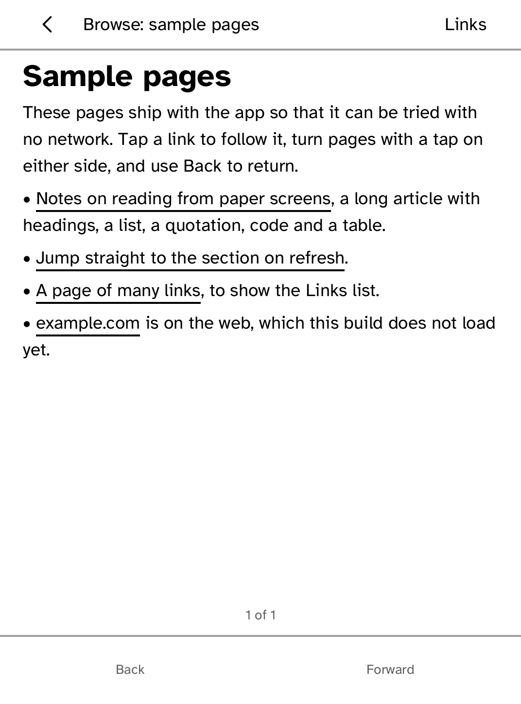
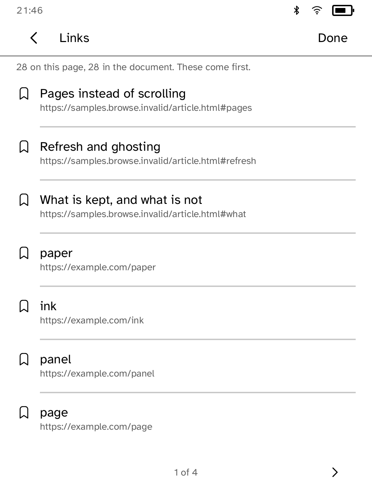
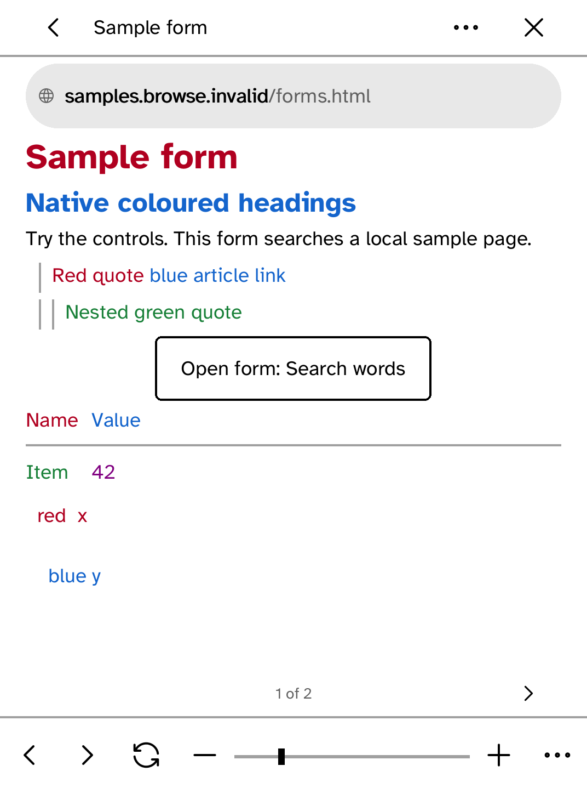
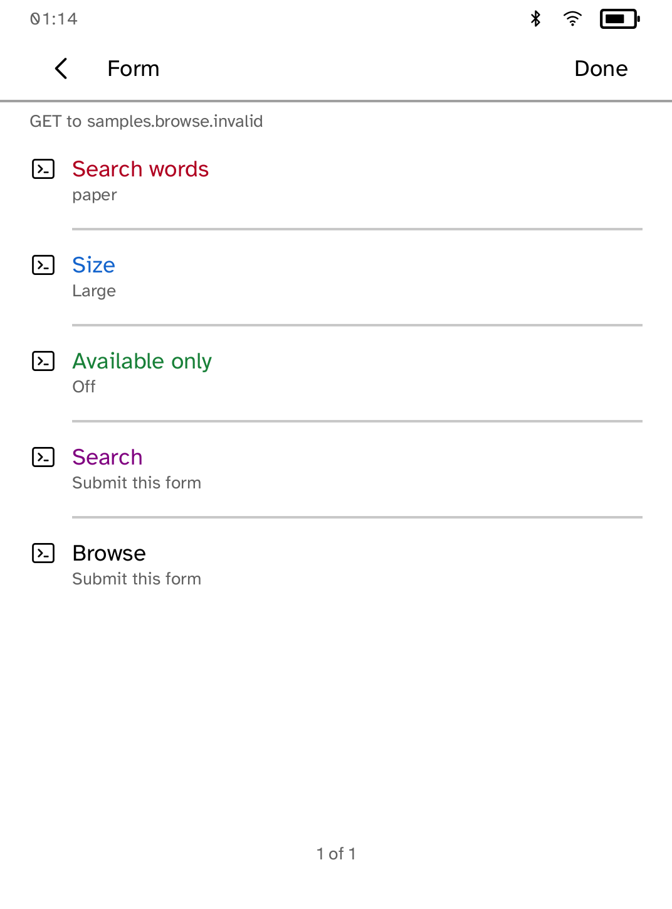

# Browser

Read web pages the way you read a book: laid out in pages, turned with a tap.

<table>
<tr>
<td width="50%" valign="top"> The sample pages</td>
<td width="50%" valign="top"> An article laid out in pages</td>
</tr>
<tr>
<td width="50%" valign="top"> Every link on a page, in a list</td>
<td width="50%" valign="top"> A link to a section opens on its page</td>
</tr>
</table>

## Features

- Pages are cut to fit the screen and the type size, and turned with a tap on
  either side. The position is shown at the bottom.
- Headings, paragraphs, lists, quotations, code and tables are kept. Supported
  inline CSS is parsed. Scripts, frames, video and active content are dropped.
- Pages load over the network. A page that fails to arrive says why, and
  offers Try again when that could help.
- Tap a link to follow it. **Links** lists every link in the page, the ones on
  the page you are reading first.
- **Back** and **Forward** return to where you were, on the same page.
- **Go to** takes an address, or words to search for.
- A link to a section opens on the page that section starts on.

## Limits

There is no JavaScript. Page view draws bounded PNG/JPEG base64 data images;
external and SVG images are unavailable. Linked images remain available in
Navigate > Links, not by tapping inside the painted picture. The native
reader keeps its image/link fallback. Pages are read up to 2 MB. The runtime
reports only the body of a response, so relative links on a page that was redirected are resolved from
the address that was asked for, unless the page names its own base.

### Painted Page view prototype

Navigate > Page view paints the arriving HTML at 2 device pixels per CSS
pixel and sends only the current screen as a picture. Decoded images can
trigger one bounded re-layout to fit the actual container width.
Reader returns to the native reader at its previous place. The count is in
the title bar so it cannot cover page ink. Page view uses the measured
picture slot inside the toolbars, not a full-panel picture behind them.

Links are listed under Navigate > Links for the painted screen only. The
current SDK reports named actions, not coordinates inside pictures, so a
painted link cannot yet be tapped directly. Form documents stay in the
native reader, where controls work. Truncated or substantially skipped
paint also keeps Reader. Supported fresh pages on confirmed Colour panels
open in Page view to preserve authored RGB. BW keeps its Reader-first default.
Forms, saved-copy notices and restored/fragment positions retain native Reader.
On confirmed Colour profiles, native Reader carries supported same-DOM authored
RGB foreground/background through prose, links, headings, quotes, preformatted
text, table cells and explicit control titles. Preformatted blocks use the embedded
fixed-pitch face, with reading-size measurement and painting, including long-token
wrapping, indentation and blank lines. Inline code in prose also uses the fixed-pitch
face, with mixed-run wrapping and link geometry. Code inside headings, quotes
and table cells still uses each block's face. Same-DOM native Colour prose also
maps computed bold/italic treatments and normal resets onto synthetic glyph
styles, not authored font-file selection. Late identity refresh retains
edited form values, notices and native place when retained source is available.
This is not a claim that all CSS, fonts or image formats are supported.
External images, SVG, external stylesheets, painted form controls, saved
painted-page positions, and device memory measurements remain follow-up work.
Data-image preparation caps each page at 4 MiB compressed bytes and 1,048,576
decoded pixels, with separate lower DOM resource-attribute retention limits.
Image geometry remains a counted approximation, with nearest sampling.
`drive-images.kobo` covers decoded and narrow-container images, scoped image
links and navigation to the target article.

`drive-page.kobo` covers Page view, scoped links, link navigation and Back,
page turns and the Reader switch. Run with the current checkout's simulator
on `clara-bw-391` and `clara-colour-393`. The normal `drive.kobo` continues
to cover the native reader. No live network is required for either script.

### Native colour coverage, November 24, 2026

These are actual Clara Colour simulator captures, ideal RGB rather than
calibrated physical-panel appearance. The page and the form remain native
controls. Matching protocol-20 app and runtime required for all shown paths;
the runtime still reads versions11-19, and old plain-node wire bytes are kept.
Older peers refuse colour payloads they cannot read instead of misreading them.

- Text colour is tied to the same parsed DOM source, not matched by words.
- Native headings, quotes and table cells retain inline bold/slant treatments;
  these are synthetic treatments on installed type, not arbitrary CSS families.
- Preformatted text keeps spaces and blank lines, using the existing native
  face. Inline code and preformatted text do not yet select a monospaced face.
- Control colours apply to the actual authored title source. Generated labels
  and details stay neutral. Nested multicolour labels, per-option and editable
  value styling are not complete authored-control styling.
- More than256 native colour spans are simplified with a visible note, keeping
  text. Heavy heading/quote/table fragmentation can use plain text to preserve
  the tail and following content within the layout budget.

Physical colour quality, device RSS/latency, complete font/CSS fidelity and
unsupported formats remain unverified or unsupported. These captures do not
close the Nickel-equivalence or hardware-readiness gates.

### Start page and address field

Launch opens a local search-first start page, not the sample document. Tap
Search or enter address to type a query or URL. Search uses the existing
HTML search provider; the start page does not contact a site until you submit.
Sample pages remain available from the start page, along with Bookmarks and
History. Navigate > Start returns there.

Native pages and Page view retain a URL field above content. Tap it to edit
the current URL. The bottom Go to action starts a fresh query. Both page
measurement paths reserve the address field before pagination or raster,
so it cannot hide the last line. The keyboard edits the field inline, with caret movement and number/symbol
layouts. No animation, script, or refresh timer was added. `drive-start.kobo` exercises
the start field, samples, Page view's address field, and its editor.

`drive-colour.kobo` captures authored heading/text/link colours and PNG images
with `shot-colour` on a Colour profile. Ordinary `shot` is greyscale even on
that profile. Colour captures are ideal RGB, not calibrated panel appearance.
`drive-forms.kobo` covers explicit GET submit-button choices and POST's
review-only refusal. Only the visible chosen GET button contributes its value.

### Painted-link touch checkpoint

Visible painted links now respond directly to a tap, including zoomed pages.
A bounded source-pixel region list follows the uploaded raster; ambiguous
clusters stay inert rather than opening the wrong destination. Use Navigate >
Links for the full list. Protocol23 is required for interactive pictures, with
older plain picture bytes unchanged. `drive-painted-touch.kobo` reproduces a
Clara Colour link tap, article arrival and Back. This fixes interaction, not the
remaining compact-chrome/scrolling or full-web compatibility gaps.

### Unified browsing header

The address now shares one top strip with Back and Close rather than sitting
under a separate title row. Navigate is under the bottom More menu. Keyboard
editing stays inline and page position is visible above the bottom toolbar.
The draggable zoom control remains available. Protocol24 carries the explicit
unified-browser style; old styles retain their wire values. This is a smaller
frame, not smooth scrolling or a full-web compatibility claim.

### Settled scrolling in Page view

Drag a painted page up or down to move by the distance of the drag. It redraws
once when you lift your finger, rather than animating on every motion event.
Links keep their positions in the visible window; a tiny tap still opens one,
and a drag does not accidentally open the link at release. Address editing
keeps the current offset. Back/Forward restore bounded in-session offsets, not
offsets across app restarts. Native Reader and forms remain paginated.
Protocol25 is required for scroll-enabled pictures. `drive-scroll.kobo` replays
an article drag and inline keyboard. Device input uses the same recognizer as
the simulator, but hardware responsiveness and panel quality are not measured.
