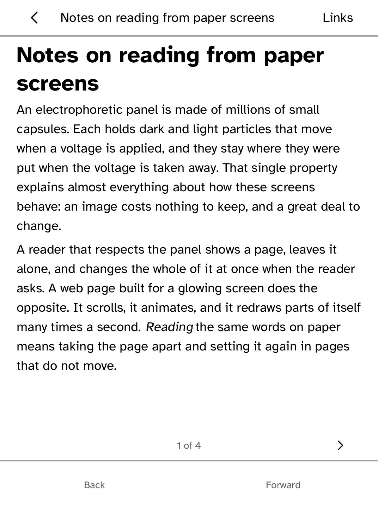
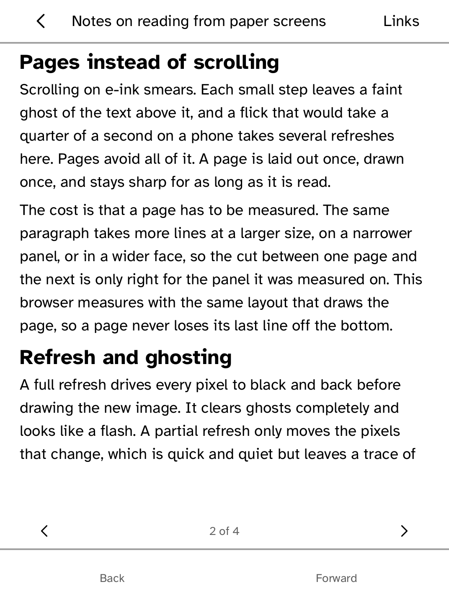

# Browser

Read web pages the way you read a book: laid out in pages, turned with a tap.

<table>
<tr>
<td width="50%" valign="top"> The sample pages</td>
<td width="50%" valign="top"> An article laid out in pages</td>
</tr>
<tr>
<td width="50%" valign="top"> Every link on a page, in a list</td>
<td width="50%" valign="top"> A link to a section opens on its page</td>
</tr>
</table>

## Features

- Pages are cut to fit the screen and the type size, and turned with a tap on
  either side. The position is shown at the bottom.
- Headings, paragraphs, lists, quotations, code and tables are kept. Scripts,
  styles, frames, video and advertising are dropped.
- Pages load over the network. A page that fails to arrive says why, and
  offers Try again when that could help.
- Tap a link to follow it. **Links** lists every link in the page, the ones on
  the page you are reading first.
- **Back** and **Forward** return to where you were, on the same page.
- **Go to** takes an address, or words to search for.
- A link to a section opens on the page that section starts on.

## Limits

There is no JavaScript. Images are not drawn yet; a linked image is offered
as a link. Pages are read up to 2 MB. The runtime reports only the body of a
response, so relative links on a page that was redirected are resolved from
the address that was asked for, unless the page names its own base.

### Painted Page view prototype

Navigate > Page view paints the arriving HTML at 2 device pixels per CSS
pixel, lays it out once, and sends only the current screen as a picture.
Reader returns to the native reader at its previous place. The count is in
the title bar so it cannot cover page ink. Page view uses the measured
picture slot inside the toolbars, not a full-panel picture behind them.

Links are listed under Navigate > Links for the painted screen only. The
current SDK reports named actions, not coordinates inside pictures, so a
painted link cannot yet be tapped directly. Form documents stay in the
native reader, where controls work. Truncated or substantially skipped
paint also keeps Reader. Page view is opt-in and is not a parity claim.
Images, external stylesheets, painted form controls, saved painted-page
positions, and device memory measurements remain follow-up work.

`drive-page.kobo` covers Page view, scoped links, link navigation and Back,
page turns and the Reader switch. Run with the current checkout's simulator
on `clara-bw-391` and `clara-colour-393`. The normal `drive.kobo` continues
to cover the native reader. No live network is required for either script.

### Start page and address field

Launch opens a local search-first start page, not the sample document. Tap
Search or enter address to type a query or URL. Search uses the existing
HTML search provider; the start page does not contact a site until you submit.
Sample pages remain available from the start page, along with Bookmarks and
History. Navigate > Start returns there.

Native pages and Page view retain a URL field above content. Tap it to edit
the current URL. The bottom Go to action starts a fresh query. Both page
measurement paths reserve the address field before pagination or raster,
so it cannot hide the last line. The keyboard is modal and static; no
animation, script, or refresh timer was added. `drive-start.kobo` exercises
the start field, samples, Page view's address field, and its editor.
